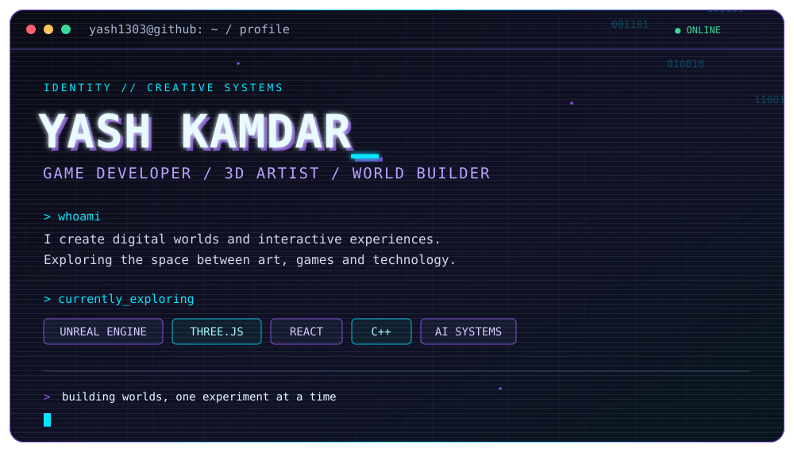

---

## `~/projects`

| 01 | PROJECT | DESCRIPTION |
|:--:|:--|:--|
| `GAME` | **PROJECT REV** | Endless procedural driving. Atmospheric worlds, changing weather, open-road exploration. |
| `GAME` | **SOLITUDE** | A quiet atmospheric walking simulator built around exploration and environmental storytelling. |
| `AI` | **PROJECT HARMONY** | An AI assistant exploring accessible models and local AI infrastructure. |
| `AI` | **REMEMBER WHAT MATTERS** | A personal knowledge system that organizes saved information and resurfaces it when useful. |

---

<code>yash1303@github:~$</code> <em>building worlds, one experiment at a time.</em>

