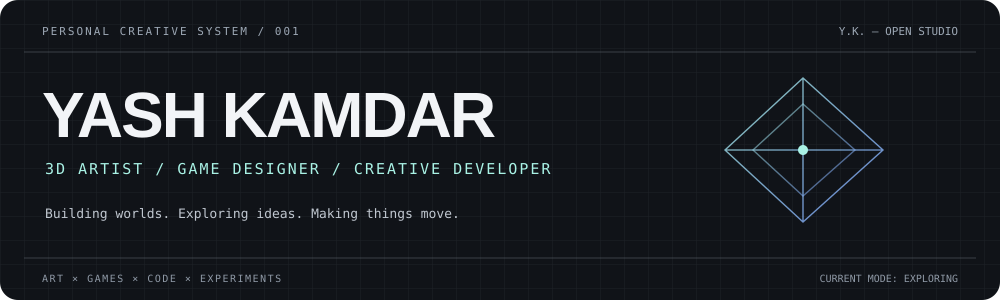
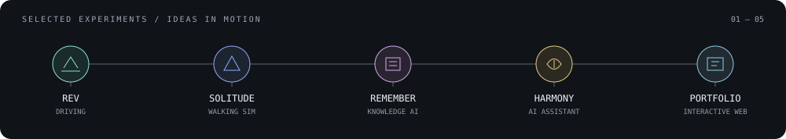

<a href="https://yashkamdar.vercel.app/">PORTFOLIO</a> ·
<a href="https://www.artstation.com/yaaaaashk">ARTSTATION</a> ·
<a href="https://www.linkedin.com/in/yashkamdar1303/">LINKEDIN</a> ·
<a href="https://www.instagram.com/_ahundredhuess_">INSTAGRAM</a>

---

### / 01 — A little about me

I'm Yash, a 3D artist and game designer interested in the spaces where art, games and technology meet. I build environments and props, prototype ideas in Unreal Engine, and experiment with code to make interactive things for the web.

I don't think of myself as only one thing. Sometimes I'm building a world, sometimes I'm sketching an idea, and sometimes I'm figuring out how to make the browser do something unexpected.

### / 02 — Things I make

| 3D & environment art | Games & worlds |
|:--|:--|
| Environments · Props · 3D modelling · Materials · Texturing · Lighting | Game design · Unreal Engine · Blueprints · Prototyping · World building |
| **Creative development** | **Other explorations** |
| Interactive web · Three.js · React · Generative experiments · Creative coding | Digital art · Sketching · AI experiments · Gaming · Drift, my clothing project |

### / 03 — Work in progress

| Project | What it is |
|:--|:--|
| **Project Rev** | An atmospheric endless-driving experience built around procedural landscapes, changing weather and open-ended exploration. |
| **SOLITUDE** | An atmospheric walking simulator focused on exploration, quiet moments and environmental storytelling. |
| **Remember What Matters** | An AI-powered personal knowledge system that brings saved information back when it becomes useful. |
| **Project Harmony** | An experiment in building a personal AI assistant, with a focus on local AI infrastructure. |
| **Creative portfolio** | An interactive 3D portfolio exploring tools, motion and playful ways to present creative work. |

These are ongoing experiments and ideas. The profile links to my public portfolio; private or unfinished repositories are intentionally not linked.

### / 04 — Tools on the desk

**3D / Art**  
`3ds Max` · `Blender` · `Substance 3D Painter` · `Photoshop` · `Illustrator`

**Games**  
`Unreal Engine 5` · `Blueprints` · `C++`

**Web / Code**  
`HTML` · `CSS` · `JavaScript` · `TypeScript` · `React` · `Three.js` · `React Three Fiber` · `Vite` · `Tailwind CSS` · `Node.js`

**Making & sharing**  
`Git` · `GitHub` · `After Effects` · `Premiere Pro`

### / 05 — Outside the viewport

When I'm not making things, I'm usually playing games, sketching, collecting references or exploring ideas for the next project. I also run **Drift**, a small clothing-brand project built around graphic tees and streetwear.

---

### / 06 — The contribution trail

<picture>
  <source media="(prefers-color-scheme: dark)" srcset="https://raw.githubusercontent.com/yash1303/yash1303/output/github-snake-dark.svg" />
  <source media="(prefers-color-scheme: light)" srcset="https://raw.githubusercontent.com/yash1303/yash1303/output/github-snake.svg" />
  
</picture>

Made with curiosity, too many ideas, and a willingness to figure things out.

  
<a href="https://yashkamdar.vercel.app/">EXPLORE MY WORK ↗</a>

