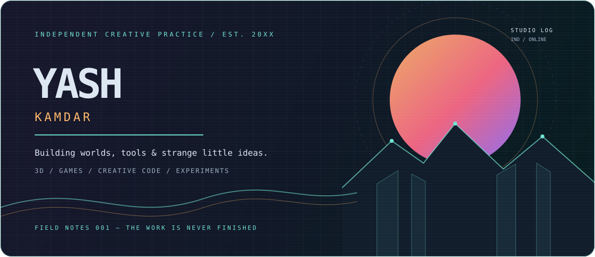

<div align="center">
  
</div>

<br/>

<div align="center">
  <sub>✳ 3D WORLDS &nbsp; / &nbsp; INTERACTIVE THINGS &nbsp; / &nbsp; EXPERIMENTAL IDEAS</sub>
</div>

<br/>

<table>
<tr>
<td width="58%" valign="top">

### 01 — A LITTLE ABOUT THE PRACTICE

I make things that sit somewhere between **games, spaces, and digital experiences**.

Sometimes that's a world you can get lost in. Sometimes it's a tool, a visual experiment, or an idea that refuses to stay in a notebook.

I'm interested in atmosphere, interaction, world-building, and the details that make digital spaces feel alive.

</td>
<td width="42%" valign="top">

### CURRENT MODE

```text
STATUS    exploring
FOCUS     worlds + systems
MEDIUM    3D / code / games
LOCATION  somewhere online
```

[PORTFOLIO ↗](https://yashkamdar.vercel.app/)  
[ARTSTATION ↗](https://www.artstation.com/yaaaaashk)  
[LINKEDIN ↗](https://www.linkedin.com/in/yashkamdar1303/)

</td>
</tr>
</table>

---

## 02 — SELECTED WORLDS & EXPERIMENTS

*A few things currently taking shape.*

<table>
<tr>
<td width="50%" valign="top">

**01 / PROJECT REV**  
<sub>GAME SYSTEMS · PROCEDURAL WORLDS</sub>

An endless road-trip through shifting landscapes. A quiet driving experience built around atmosphere, weather, and the simple pleasure of moving forward.

</td>
<td width="50%" valign="top">

**02 / SOLITUDE**  
<sub>WALKING SIMULATOR · ENVIRONMENTAL STORYTELLING</sub>

A slow journey through an atmospheric world. Built around exploration, visual storytelling, and the feeling of being somewhere unfamiliar.

</td>
</tr>
<tr>
<td width="50%" valign="top">

**03 / HARMONY**  
<sub>AI · LOCAL-FIRST SYSTEMS</sub>

An exploration of what an accessible, personal AI assistant could look like, with an interest in local models and practical everyday use.

</td>
<td width="50%" valign="top">

**04 / REMEMBER WHAT MATTERS**  
<sub>PERSONAL KNOWLEDGE · AI</sub>

A system for bringing useful saved information back when it becomes relevant, instead of letting good ideas disappear into a pile of bookmarks.

</td>
</tr>
</table>

---

## 03 — THE WORKSHOP

Not a leaderboard. Just the materials I like working with.

| 3D & WORLD BUILDING | CREATIVE DEVELOPMENT | MAKING GAMES |
|:--|:--|:--|
| 3ds Max · Blender | JavaScript · TypeScript | Unreal Engine |
| Substance 3D Painter | React · Three.js | C++ · Blueprints |
| Materials · Lighting | HTML · CSS · WebGL | Level design · Prototyping |

---

## 04 — OPEN TABS

Things I'm curious about lately:

`procedural environments` &nbsp; `creative coding` &nbsp; `shader experiments`  
`interactive portfolios` &nbsp; `game feel` &nbsp; `atmospheric storytelling`

---

<div align="center">
  <sub>MADE WITH CURIOSITY. BUILT ONE EXPERIMENT AT A TIME.</sub>
</div>
