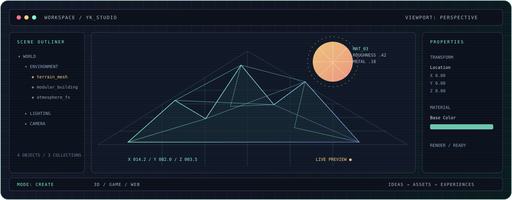

<div align="center">
  
</div>

<div align="center">
  <code>YASH KAMDAR</code> &nbsp; / &nbsp; <code>3D ARTIST</code> &nbsp; / &nbsp; <code>CREATIVE DEVELOPER</code>
  <br/>
  <sub>MAKING DIGITAL WORLDS, INTERACTIVE SPACES &amp; EXPERIMENTAL THINGS</sub>
</div>

<br/>

<table>
<tr>
<td width="60%" valign="top">

## `01` — WHO'S AT THE WORKSTATION?

I'm a 3D artist and game designer interested in building worlds that feel like places, not just scenes.

My work moves between environment art, game development, and creative web experiments. I enjoy shaping an atmosphere in 3D, then using code to make an idea interactive.

**I think in scenes. I build with tools. I experiment with code.**

</td>
<td width="40%" valign="top">

## `NOW / OPEN PROJECTS`

```text
[01] PROJECT REV
     procedural driving worlds

[02] SOLITUDE
     atmospheric exploration

[03] HARMONY
     personal AI experiments

[04] REMEMBER WHAT MATTERS
     useful memory, resurfaced
```

</td>
</tr>
</table>

---

## `02` — THE WORKBENCH

<sub>TOOLS ARE JUST DIFFERENT WAYS TO MAKE SOMETHING.</sub>

| 3D / ENVIRONMENT ART | GAME DEVELOPMENT | CREATIVE WEB |
|:--|:--|:--|
| 3ds Max | Unreal Engine 5 | HTML / CSS |
| Blender | Blueprints | JavaScript |
| Substance 3D Painter | C++ | TypeScript |
| Materials & lighting | World building | React / Three.js |

---

## `03` — PROJECT VIEWPORT

<table>
<tr>
<td width="50%" valign="top">

### ◈ PROJECT REV
<sub>GAME DEVELOPMENT / PROCEDURAL ENVIRONMENTS</sub>

An endless driving experience built around atmospheric landscapes, changing weather, and the freedom to keep moving.

</td>
<td width="50%" valign="top">

### ◈ SOLITUDE
<sub>GAME DEVELOPMENT / ENVIRONMENT STORYTELLING</sub>

A quiet walking simulator focused on exploration, atmosphere, and telling stories through the environment.

</td>
</tr>
<tr>
<td width="50%" valign="top">

### ◈ PROJECT HARMONY
<sub>AI / SYSTEM DESIGN</sub>

Exploring an accessible personal AI assistant, with an interest in local models and useful everyday workflows.

</td>
<td width="50%" valign="top">

### ◈ REMEMBER WHAT MATTERS
<sub>AI / PERSONAL KNOWLEDGE</sub>

A system that organizes saved information and brings it back when it can actually be useful.

</td>
</tr>
</table>

---

## `04` — CURRENT INTERESTS

`WORLD BUILDING` &nbsp; `PROCEDURAL ART` &nbsp; `SHADERS` &nbsp; `CREATIVE CODING`  
`INTERACTIVE 3D` &nbsp; `GAME FEEL` &nbsp; `ENVIRONMENTAL STORYTELLING`

---

<div align="center">
  <a href="https://yashkamdar.vercel.app/">PORTFOLIO</a>
  &nbsp; ✳ &nbsp;
  <a href="https://www.artstation.com/yaaaaashk">ARTSTATION</a>
  &nbsp; ✳ &nbsp;
  <a href="https://www.linkedin.com/in/yashkamdar1303/">LINKEDIN</a>
  <br/><br/>
  <sub>BUILT FROM CURIOSITY — NOT JUST COMMIT HISTORY.</sub>
</div>
